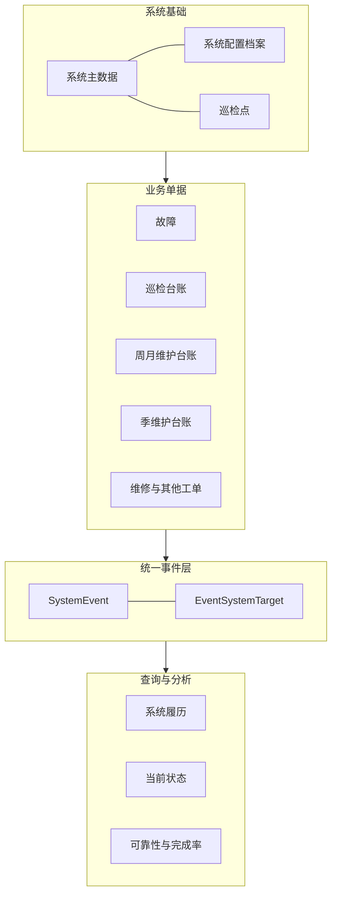

# 设备全生命周期管理总体方案

> 版本：V3.1（未启用旧结构直接重建稿）
> 编制日期：2026-09-18
> 适用范围：设备全生命周期模块内的系统主数据、系统配置档案、故障、巡检、周月维护、季维护、工单及系统履历
> 修订说明：本版明确原设备生命周期和旧故障功能仍处于设计阶段、尚未启用且无业务数据，在原 `equipment_lifecycle` 应用位置删除旧实现后重建；现有“设备管理”和“系统升级”保持不变。

## 1. 方案摘要

本方案在现有 `equipment_lifecycle`（设备生命周期）应用内实施，并将菜单统一为“设备全生命周期”。方案以“系统”为核心管理对象，统一管理系统主数据、系统配置档案、故障、巡检、周月维护、季维护、工单和运行履历。

本版不建立逐台设备资产管理体系。服务器、交换机、板卡、模块等具体设备，默认只作为系统配置组成项或业务事件发生时的现场描述，不建立独立状态、系统—设备关系和设备履历。已有设备台账继续保留，作为历史资料或外部资产信息来源，不再作为新方案流程运行的前提。

核心结论如下：

1. 系统是故障、巡检、周月维护、季维护、工单和履历的统一业务对象。
2. 一个系统对象代表某地点实际运行的一套系统实例，不代表抽象产品类型。
3. 系统的固定属性和个性化属性通过可配置的系统配置档案管理，不要求每台设备逐一建档。
4. 具体设备信息仅在确有需要时记录为配置组成项、资产引用或事件快照。
5. 业务单据是事实来源，系统履历由业务动作自动生成，不重复录入。
6. 系统运行状态由故障、工单和恢复确认共同决定。
7. 巡检、周月维护和季维护以台账表格录入为主，一张表可以汇总多个系统的检查或维护项目。

## 2. 方案目标和范围

### 2.1 方案目标

- 建立统一、稳定的系统主数据，消除故障记录中的自由系统名称。
- 形成覆盖日常运行、故障处置、配置变更、巡检、周月维护、季维护和维修的业务闭环。
- 通过系统配置档案了解系统当前及历史的组成、版本和关键配置。
- 将故障、巡检、周月维护、季维护和工单统一关联到系统。
- 建立可追溯、不可静默覆盖的系统履历。
- 在满足运维管理的前提下降低建档、维护和实施成本。

### 2.2 本方案范围

- 系统主数据。
- 系统运行状态。
- 系统配置档案、类型模板及历史变更。
- 故障、巡检、周月维护、季维护和维修工单。
- 统一系统履历、提醒、统计和审计。
- 设备全生命周期旧结构和旧故障结构的删除重建。

### 2.3 明确不纳入的范围

- 单台设备的采购、到货、入库、领用、调拨、借用、折旧、报废和处置。
- 系统—设备多对多关系及其历史有效期管理。
- 可追踪部件的建档、安装、拆卸、移动和独立履历。
- 完整仓储、备件库存、财务资产和采购审批。
- 强制将所有存量设备逐台映射到系统。
- 所有低价值设备和耗材的逐件编码。
- 现有“设备管理”中的设备台账、设备履历和系统升级改造。
- 本期不把现有系统升级嫁接到设备全生命周期，只预留后续接入能力。

上述能力应优先由现有固定资产、采购、库存等系统承担。本系统只保存必要的外部编号、引用或业务快照。

### 2.4 强制模块边界

本方案实施时必须遵守以下边界：

1. 所有新页面、API、模型、权限和测试均落在 `equipment_lifecycle` 模块，前端继续使用 `spug_web/src/pages/equipmentLifecycle/`，后端继续使用 `spug_api/apps/equipment_lifecycle/` 和 `/equipment-lifecycle/` API 前缀，不在 `device`、`upgrade` 或旧 `fault` 模块上增量拼接。
2. 现有“设备生命周期”属于尚未启用的过期设计，不存在需要保留或迁移的业务数据，也不保留兼容层。旧设备档案、系统档案、设备关系、位置变更和位置历史页面、接口、模型和权限全部删除，菜单统一更名为“设备全生命周期”，再按本方案重建。
3. 现有“设备管理”中的设备台账和设备履历保持原样，`spug_web/src/pages/device/`、`spug_api/apps/device/` 及其数据库表不修改、不迁移、不复用为新模块主数据。
4. 现有“设备管理”中的系统升级保持原样，`spug_web/src/pages/upgrade/`、`spug_api/apps/upgrade/` 及其数据库表本期不修改。新模块只预留稳定系统 ID、事件来源和配置变更接口，后续另行实施嫁接。
5. 旧“故障管理”是上述冻结边界的唯一例外：只从现有“设备管理”菜单中移除旧故障子入口，不调整其他子菜单、路由和权限；不复用 `apps.fault` 的页面、模型、接口、权限或表结构，删除旧故障实现后，在 `equipment_lifecycle` 内按系统中心结构重新实现故障管理。
6. 不允许新模块直接写入 `DeviceResume`、`DeviceEvent`、`UpgradeRecord` 或旧 `FaultRecord`、`FaultPart`。
7. 必须删除旧设备生命周期表 `tdyw_el_device`、`tdyw_el_device_location`、`tdyw_el_system`、`tdyw_el_system_device_relation`，以及旧故障表 `tdyw_fault_records`、`tdyw_fault_parts`；不得仅隐藏页面或停用接口而保留过期业务表。

## 3. 核心概念和管理粒度

### 3.1 系统

系统是能够独立明确责任主体、运行状态、配置档案和故障影响范围的实际运行单元。

系统建档遵循以下粒度规则：

- 同一名称但部署地点、责任主体或运维边界不同的，应建立不同系统对象。
- 同一地点内不能独立运行、不能独立定责的组成部分，不单独建立系统对象。
- 所有系统保持平级，不设置父系统、子系统或树形层级。
- 系统类型用于分类，不能代替具体系统实例。

例如，“某型号通信系统”是系统类型，“烟台中心站通信系统”才是具体系统对象。

### 3.2 系统配置档案

系统配置档案采用“固定核心字段 + 系统类型模板 + 用户自定义字段 + 可选组成项”的混合结构。它用于说明系统的实际属性、组成和关键配置，不把每台设备变成独立管理对象。

系统配置档案的默认字段参考现有“新增设备档案”表单进行系统化转换，尽量延续用户已经熟悉的录入习惯。系统管理员可以为系统类型定义扩展字段，用户再为具体系统填写实际值。

支持的自定义字段类型包括：文本、长文本、数字、日期、单选、多选、布尔值、附件和明细表。字段可以配置是否必填、默认值、选项、格式校验、可见范围和可编辑角色。

系统配置档案可按需要记录：

- 软件、应用和固件版本。
- 网络、接口、频率等必要配置摘要。
- 设备、软件、模块、链路等组成项的名称、类别、型号、数量和用途。
- 可选的资产编号、序列号或外部系统引用。
- 拓扑、配置文件和其他附件。

自定义字段用于适应不同系统类型的差异。例如通信系统可配置频率和接口字段，软件系统可配置数据库和版本字段。字段定义不能包含密码、令牌和私钥。

### 3.3 巡检点

巡检点是系统内需要检查的稳定位置或功能点，例如机柜、电源区域、主用服务器区、操作席或链路状态。巡检点用于组织台账检查项，但不是设备资产，也不形成独立履历。

### 3.4 业务单据和履历事件

故障单、巡检台账、周月维护台账、季维护台账和工单是本期业务事实来源。

系统履历事件由业务动作生成，保存来源、动作、发生时间、操作人、关联系统及事件发生时快照。履历不是第二套业务表，不允许脱离业务单据重复维护。

## 4. 总体业务架构



总体原则：

- 系统主数据提供稳定 ID，业务模块不得继续只保存自由填写的系统名称。
- 系统配置档案描述系统属性和组成，业务事件描述系统发生了什么。
- 业务单据完成自身事务后，通过统一履历服务生成事件。
- 一条事件可以按目标角色关联一个或多个系统。

## 5. 系统主数据

### 5.1 系统主数据

| 字段 | 含义 | 规则 |
| --- | --- | --- |
| `system_code` | 系统编号 | 租户内唯一，启用后原则上不可修改 |
| `name` | 系统正式名称 | 必填，可变更但保留历史快照 |
| `system_type` | 系统类型 | 必填，用于分类和字段模板 |
| `system_model` | 系统型号 | 默认必填，可按系统类型调整 |
| `install_location` | 安装地点 | 必填 |
| `geo_coordinate` | 安装经纬度 | 可选，格式为经度、纬度 |
| `system_purpose` | 系统用途 | 可选，最长 500 字 |
| `manufacturer` | 生产厂家 | 默认必填，可按系统类型调整 |
| `install_unit` | 安装单位 | 默认必填，可按系统类型调整 |
| `use_unit` | 使用单位 | 必填 |
| `install_time` | 安装时间 | 默认必填，可按系统类型调整；仅作档案信息 |
| `enable_time` | 启用时间 | 默认必填，可按系统类型调整；仅作档案信息 |
| `responsible_user_name` | 系统负责人 | 必填，首期沿用姓名录入方式 |
| `health_status` | 运行健康状态 | 由业务事实计算或受控确认 |
| `is_active` | 是否可用 | 仅控制业务候选项，不表达运行状态 |
| `remark` | 备注 | 可选，最长 1000 字 |
| 审计字段 | 创建、更新、停用等信息 | 必须 |

系统编号、名称、型号、安装地点、使用单位、负责人和状态延续现有设备档案的主要录入结构。系统改名、调整负责人或安装地点时，不覆盖历史事件中的快照。

### 5.2 删除保护

已被故障、巡检、工单或履历引用的系统不得物理删除。系统不再使用时，只关闭其业务候选资格或软删除，历史记录必须继续可查。

## 6. 系统配置档案

### 6.1 配置结构

系统配置采用分层结构：

```text
固定核心字段
└─ 所有系统共同具备，由平台定义

系统类型模板
└─ 管理员为某类系统配置通用扩展字段

系统自定义字段
└─ 经授权后为某个具体系统补充个性字段

可选组成项
└─ 按需要记录设备、软件、模块或链路，不要求逐台建档
```

固定核心字段使用正式数据库字段，保证权限、查询和业务关联稳定。动态字段和值使用独立的字段定义和配置值模型，不把全部配置塞进一个无约束、不可查询的 JSON 字段。

### 6.2 参考现有设备档案的字段转换

系统配置档案字段以现有“新增设备档案”表单为主要参考，转换关系如下：

| 现有设备档案字段 | 系统配置档案字段 | 处理方式 |
| --- | --- | --- |
| 设备资产编号 | 系统编号 | 固定核心字段，租户内唯一 |
| 设备名称 | 系统名称 | 固定核心字段，必填 |
| 设备型号 | 系统型号 | 固定核心字段，默认必填，可按类型调整 |
| 工作频率 | 工作频率 | 通信类系统模板字段，可选 |
| 设备呼号 | 系统呼号 | 通信类系统模板字段，可选 |
| 安装地点 | 安装地点 | 固定核心字段，必填 |
| 安装经纬度 | 安装经纬度 | 固定核心字段，可选 |
| 设备用途 | 系统用途 | 固定核心字段，可选 |
| 生产厂家 | 生产厂家 | 固定核心字段，默认必填，可按类型调整 |
| 安装单位 | 安装单位 | 固定核心字段，默认必填，可按类型调整 |
| 使用单位 | 使用单位 | 固定核心字段，必填 |
| 安装时间 | 安装时间 | 固定核心字段，默认必填，可按类型调整 |
| 启用时间 | 启用时间 | 固定核心字段，默认必填，可按类型调整 |
| 设备负责人 | 系统负责人 | 固定核心字段，必填 |
| 当前设备状况 | 运行健康状态 | 固定核心字段，改用系统状态枚举 |
| 备注 | 备注 | 固定核心字段，可选 |

安装时间和启用时间只作为档案字段使用。工作频率和呼号只在适用的系统类型中显示，其他系统不出现无关字段。

初始表单可以延续现有设备档案的分栏习惯：

- 基础信息：系统编号、系统名称、系统类型、系统型号、安装地点，以及按类型显示的工作频率和系统呼号。
- 扩展信息：系统用途、安装经纬度和备注。
- 时间与单位：生产厂家、安装单位、使用单位、安装时间和启用时间。
- 负责人和状态：系统负责人、运行健康状态和是否可用。

默认必填规则参考现有设备档案：编号、名称、型号、安装地点、生产厂家、安装单位、使用单位、安装时间、启用时间、负责人和状态必填；频率、呼号、用途、经纬度和备注可选。考虑不同系统差异，除系统编号、名称和类型外，其他字段的必填规则允许在系统类型模板中调整。

现有设备状态不能原样套用。系统运行健康状态建议使用“正常、降级、故障、维修中、中断、未知”；原设备状态中的“停用、报废”不进入系统运行状态，系统是否可继续被业务选择由 `is_active` 单独控制。

### 6.3 系统类型模板

系统管理员可以为每种系统类型配置字段模板。字段定义至少包括：

- 稳定字段编码和显示名称。
- 字段类型、帮助文字和显示顺序。
- 是否必填、默认值和格式校验规则。
- 单选或多选的候选项。
- 是否允许搜索、筛选和导出。
- 可见角色和可编辑角色。
- 是否属于敏感配置。

同类系统默认继承模板。管理员新增模板字段后，可以选择只应用于新系统，或让现有系统显示为空并逐步补录，不能自动伪造默认历史值。

例如，通信系统模板可以包含频率、接口和呼号；软件系统模板可以包含应用版本、数据库类型和部署方式。两类系统共用核心字段，但不显示彼此无关的扩展字段。

### 6.4 具体系统自定义

在类型模板不能满足需要时，经授权的管理员可以为某个具体系统增加自定义字段。为避免表单失控，应满足：

- 自定义字段仍使用稳定字段编码和受支持的字段类型。
- 字段名称不得与固定字段或模板字段重复。
- 可以限制只有系统管理员能够新增字段，普通用户只填写值。
- 同一含义在三个以上系统重复出现时，应提升为系统类型模板字段。
- 字段停用后不再出现在新编辑表单中，但历史值继续保留和显示。
- 修改字段类型前必须检查已有数据并提供转换或回退方案。

### 6.5 配置组成项

- 组成项可以按类型汇总，例如“接入交换机，某型号，4 台”。
- 只有对定位、保修或审计确有价值时，才填写单台资产编号或序列号。
- 组成项调整只更新系统配置档案，不需要设备调拨流程。
- 故障和工单可以引用组成项，也允许直接填写具体对象描述。
- 组成项被修改或删除后，历史业务事件快照保持不变。

### 6.6 配置历史

系统配置档案不强制执行复杂的版本发布流程。每次保存时记录变更人、变更时间、变更来源和字段前后值，形成可查看的配置历史。

重要配置变更或技术改造完成后，可以生成一次配置快照，用于比较变更前后的差异。普通字段调整只记录变更历史，不要求用户手工创建版本。

系统类型模板发生变化时，同样记录字段新增、修改、停用及操作人。删除字段定义不得级联删除已保存值。

密码、令牌和私钥不得保存为普通字段或附件。确需引用秘密配置时，只保存密钥管理系统中的引用标识。

### 6.7 建议数据模型

| 实体 | 作用 |
| --- | --- |
| `SystemType` | 系统类型和模板归属 |
| `ConfigFieldDefinition` | 字段编码、类型、作用范围、校验、顺序和权限 |
| `SystemConfigValue` | 具体系统在某个字段下的当前值 |
| `SystemConfigComponent` | 可选的设备、软件、模块或链路组成项 |
| `SystemConfigChange` | 字段或组成项变更前后值、来源、人员和时间 |
| `SystemConfigSnapshot` | 重要配置变更或改造时生成的可选配置快照 |

字段定义的作用范围区分系统类型和具体系统。配置值必须按字段类型校验；需要搜索和统计的字段应使用可查询的类型化值，不依赖源码约定或无约束 JSON。

## 7. 系统运行状态

系统运行状态包括正常、降级、故障、维修中、中断和未知，由故障、工单及恢复确认共同计算：

- 存在未恢复的中断故障时，显示“中断”。
- 存在执行中的维修工单时，显示“维修中”。
- 不存在中断但存在未关闭故障时，显示“故障”或“降级”。
- 无未关闭故障且完成恢复确认后，才恢复为“正常”。
- 多张故障同时存在时，关闭其中一张不能覆盖其他故障造成的状态。
- 自动计算结果和高权限人工修正均必须形成审计和履历。

“维修中”由执行中的维修工单计算，不允许在系统档案页面随意覆盖。

系统名称、安装地点、使用单位、负责人、版本、关键组成、接口和业务参数发生变化时必须保留审计。影响系统配置档案的重要变化应通过配置变更记录或工单完成。

## 8. 故障管理与未来升级嫁接预留

### 8.1 故障管理

新故障管理的页面、API、模型、权限和测试全部归属 `equipment_lifecycle`。旧 `apps.fault` 及其前端页面只作为待删除对象，不作为新功能的基类、兼容接口或数据来源；新模型不继承、包装或继续写入 `FaultRecord` 和 `FaultPart`。

故障单是故障事实的唯一来源，包含：

- 主故障系统，必须且只能有一个。
- 实际受影响系统，可多选。
- 故障时间、现象、级别和影响范围。
- 故障位置或巡检点。
- 具体对象描述，可引用配置组成项，也可填写设备型号、编号或序列号快照。
- 原因、处置过程、恢复时间和最终结果。
- 是否生成维修工单。

故障必须关联实际发生故障的系统；其他系统只有实际受到影响时，才作为受影响系统关联事件。

关闭故障后，系统根据其他未关闭故障和工单重新计算健康状态，不能无条件恢复正常。

新故障数据建议由系统故障主表、受影响系统关联、处置记录和附件关联组成。具体故障对象作为组成项引用或文本快照保存在故障单中，不再单独建设旧式“故障件管理”，也不要求先建立单台设备档案。

旧故障菜单、路由、API 注册、权限项和数据库表随旧模块一起清理；新权限统一使用 `equipment_lifecycle.fault.*`，新故障数据只能写入 `equipment_lifecycle` 新表。

### 8.2 系统升级预留边界

本期不在设备全生命周期模块内实现系统升级，也不移动、改造或调用现有“设备管理—系统升级管理”。为后续嫁接只预留：

- 正式系统 ID 关联位置。
- 可扩展的 `source_type + source_id + action` 事件来源。
- 配置变更前后差异和可选快照接口。
- 未来在“设备全生命周期”下挂载菜单的扩展位置。

后续嫁接必须作为单独项目实施，明确旧升级数据映射、菜单迁移、权限切换和回滚方案。本期不得为了预留而修改 `upgrade` 模块。

## 9. 巡检、周月维护与季维护台账

### 9.1 台账类型

运行维护台账至少包括：

- 巡检台账：记录日常或按班次开展的检查。
- 周月维护台账：统一记录每周或每月固定维护内容及结果，通过维护周期区分周维护和月维护。
- 季维护台账：记录每季固定维护内容及结果。

三类台账使用统一的数据结构，通过台账类型、维护周期和模板区分。周维护与月维护共用“周月维护”入口和台账类型，明细周期分别标记为“周”或“月”。后续增加半年维护或年度维护时，不需要重新建立一套业务模型。

### 9.2 统一业务模型

```text
台账模板
→ 台账计划（可选）
→ 台账记录/汇总表
→ 台账明细
→ 异常
→ 故障单、工单或待办
```

巡检、周月维护和季维护以台账录入为主，不强制每次生成工单。需要提前安排和提醒时可以使用计划自动生成待填台账；临时补录也可以直接新建台账，但必须标明补录时间和原因。

建议使用统一数据模型：

| 实体 | 作用 |
| --- | --- |
| `OperationLedgerTemplate` | 巡检、周月维护或季维护模板 |
| `OperationLedgerTemplateItem` | 模板中的检查或维护项目及录入规则 |
| `OperationLedgerPlan` | 可选的周期、范围、负责人和到期规则 |
| `OperationLedger` | 一张汇总台账的表头，可覆盖多个系统 |
| `OperationLedgerItem` | 台账明细，逐条关联所属系统并保存模板快照和结果 |

台账类型使用枚举区分为巡检、周月维护和季维护；周月维护另用维护周期字段区分“周”或“月”。

### 9.3 一张表汇总多个系统

一张台账记录可以按日期、班次、机房、区域或维护周期汇总多个系统。系统不是整张表的边界，而是每条明细的归属。

台账表头建议包含：

- 台账编号和类型。
- 计划周期、实际执行日期和班次。
- 机房、区域或维护范围。
- 执行人、协作人和复核人。
- 总体说明、附件和状态。

台账明细建议包含：

- 所属系统，必须关联正式系统主数据。
- 巡检点或维护位置，可选。
- 检查或维护项目。
- 标准要求、正常范围或操作说明。
- 结果：正常、异常、不适用、待复核。
- 实测值、处理内容、异常说明和附件。
- 明细执行人和实际执行时间。

同一张表可以按系统分组显示和打印，但用户只需完成一次整表提交。正常项允许批量确认，异常项必须逐项填写说明。

### 9.4 模板和录入灵活性

管理员可以分别维护巡检、周月维护和季维护模板。周月维护模板可以包含仅每周执行、仅每月执行或周月均执行的项目。模板可以按机房、区域、系统类型或具体系统配置，并允许在生成台账时组合多个模板。

模板项目支持文本、数值、单选、多选、布尔值和附件等录入类型，并可配置必填、单位、正常范围、默认值、显示顺序和异常判定规则。

模板调整只影响之后生成的台账；已经生成或完成的台账保存当时的模板和项目快照，不能随模板变化而改变。

### 9.5 异常和履历

- 暂时无法判断时允许标记“待复核”，不得强制填正常。
- 异常可以生成故障单、维修工单或待办，并保留来源台账和明细。
- 转单后的处置由故障单或工单负责，台账不重复记录完整处置过程。
- 日常正常记录保存在台账中，不逐条堆入系统主履历。
- 异常、关键参数调整或运行状态变化生成显著系统履历事件。
- 周月维护和季维护完成情况可以按各自周期汇总进入系统履历和统计。

### 9.6 当前录入方式和扩展边界

本期仅提供平台电脑端台账录入。实际检查和维护完成后，由用户在平台填写或补录台账；补录时保存实际执行时间、录入时间、录入人和补录说明，不把录入时间当作实际执行时间。

台账表头、明细、模板快照、系统关联和异常转单均由统一后端服务处理，不与电脑端页面绑定。台账记录预留录入渠道字段，当前固定为 `WEB`；以后增加其他录入渠道时，继续写入同一套 `OperationLedger` 与 `OperationLedgerItem`，不改变现有台账、统计和履历结构。

本期不建设任何机房内采集能力。

## 10. 工单管理

### 10.1 工单边界

故障单回答“发生了什么”，工单回答“由谁、何时、怎样处理”。一个故障可以产生一张或多张工单。

工单类型包括故障维修、专项维护、安装调试、技术改造、配置变更、现场测试和校准。

巡检、周月维护和季维护默认使用台账，不重复创建工单。只有需要派发、接单、跟踪工时或结果复核的专项作业，才转为工单。

### 10.2 工单内容

工单包含编号、类型、来源、目标系统、受影响系统、作业位置、具体对象描述、优先级、人员、计划和实际时间、步骤、工时、中断时间、材料明细、结果、复核和附件。

工单不承担备件库存和设备调拨。需要逐件追踪的材料应引用外部库存或资产系统编号。

### 10.3 事件所有权

| 事件 | 主要来源 |
| --- | --- |
| 故障发生和影响范围 | 故障单 |
| 维修开始、暂停和完成 | 维修工单 |
| 系统恢复运行 | 故障关闭或恢复确认 |
| 巡检、周月维护或季维护异常 | 对应台账明细，后续事实转入故障单或工单 |
| 周月维护或季维护完成汇总 | 对应维护台账 |
| 配置档案重要变更 | 配置档案或来源业务单据 |

一条事件只能有一个主要来源，可以关联故障、工单或台账记录作为上下文。

## 11. 统一系统履历

### 11.1 数据模型

| 实体 | 作用 |
| --- | --- |
| `SystemEvent` | 事件类型、标题、摘要、时间、来源、动作、操作人和状态 |
| `EventSystemTarget` | 关联系统、目标角色及事件发生时快照 |
| `EventCorrection` | 关联原事件并保存更正原因、人员和时间 |

`EventSystemTarget.target_role` 支持：

- `PRIMARY`：事件主体系统。
- `AFFECTED`：实际受影响系统。
- `COVERED`：同一巡检、周月维护或季维护台账覆盖的系统。
- `RELATED`：关联但未直接受影响的系统。

使用 `tenant_id + source_type + source_id + action` 建立来源唯一约束，防止接口重试产生重复事件。

### 11.2 关联规则

| 业务事件 | 系统目标规则 | 来源 |
| --- | --- | --- |
| 故障发生和恢复 | 一个主体系统，可有多个受影响系统 | 故障单 |
| 工单执行和完成 | 一个主体系统，可有多个受影响系统 | 工单 |
| 巡检、周月维护或季维护异常 | 异常明细所属系统为主体，可有关联系统 | 台账明细、故障单或工单 |
| 周月维护或季维护完成汇总 | 同一事件关联台账覆盖的一个或多个系统 | 维护台账 |
| 配置档案重要变更 | 一个主体系统 | 配置档案或来源业务单据 |

### 11.3 生成规则

1. 业务模块在数据库事务中完成自身状态变化。
2. 调用统一履历服务，传入来源、动作、发生时间和系统目标。
3. 服务端重新查询系统及权限，不信任前端传来的名称和状态。
4. 保存事件时的系统编号、名称和状态快照。
5. 通过来源唯一键保证幂等。
6. 业务保存或履历生成失败时整体回滚。
7. 已发布事件不得静默修改；更正时新增记录并关联原事件。

## 12. 页面和菜单

```text
设备全生命周期
├─ 系统管理
│  ├─ 系统列表
│  ├─ 系统类型模板
│  └─ 系统配置档案
├─ 运行维护
│  ├─ 故障管理
│  ├─ 巡检台账
│  ├─ 周月维护台账
│  ├─ 季维护台账
│  ├─ 台账模板与计划
│  └─ 工单管理
└─ 履历与分析
   ├─ 系统履历
   ├─ 运行状态
   └─ 统计分析
```

系统详情包含基本信息、责任主体、当前状态、配置档案及历史、巡检台账、周月维护台账、季维护台账、故障、工单和系统履历。

上述页面全部由 `equipment_lifecycle` 提供。现有“设备管理”的设备台账、设备履历和系统升级保持原菜单、原页面、原路由、原权限和原数据结构，不并入本期新菜单。“设备管理”中只删除旧故障管理子入口，由“设备全生命周期—运行维护—故障管理”替代，其他内容一律不动。

## 13. 权限、审计和安全

### 13.1 权限域

- 系统主数据：`equipment_lifecycle.system.*`，覆盖查看、创建、编辑、停用和导出。
- 系统类型模板：`equipment_lifecycle.system_type.*`，覆盖查看、创建、编辑、停用字段以及调整校验和权限。
- 系统配置档案：`equipment_lifecycle.system_config.*`，覆盖查看、编辑、自定义字段管理、历史查看、快照和导出。
- 运行维护台账：`equipment_lifecycle.ledger.*`，覆盖模板、计划、创建、填写、补录、复核、导出和异常转单。
- 工单：`equipment_lifecycle.work_order.*`，覆盖创建、派发、接单、执行、复核、关闭和更正。
- 故障：`equipment_lifecycle.fault.*`，覆盖报障、定位、处置、关闭和更正。
- 履历：`equipment_lifecycle.system_event.*`，覆盖查看、导出、更正申请和高权限撤销。

前端按钮和路由权限必须与后端权限一致，后端必须独立校验。

删除旧 `equipment_lifecycle.device.*`、`equipment_lifecycle.relation.*` 等过期权限以及 `fault.faultrecord.*`、`fault.faultpart.*` 权限。由于旧功能尚未启用，不进行角色授权迁移；按新权限重新配置角色，不把旧权限编码映射成隐式兼容入口。现有 `device.*` 和 `upgrade.*` 权限保持不变。

### 13.2 审计和安全

- 系统、字段模板、配置档案和业务单据的重要创建、修改、状态变化、删除和导出必须记录审计日志。
- 关键业务事件不允许普通用户硬删除，更正必须说明原因。
- 台账补录必须保存实际执行时间、录入时间、录入人和补录说明。
- 所有查询和写入必须重新执行租户和对象范围校验。
- 密码、令牌、私钥不得写入普通字段或附件。
- IP、频率和拓扑等敏感配置按权限控制查看和导出。

## 14. 提醒和分析

逐步建立巡检、周月维护、季维护、故障工单、配置档案复核、合同维保和证书支持等到期提醒。

数据可靠后计算：

- 系统故障次数、MTTR、可用率和累计中断时间。
- 降级运行时间。
- 巡检、周月维护和季维护的完成率、逾期率和异常率。
- 工单完成率和平均处理时长。

不再以单台设备为基础计算设备年龄、设备 MTBF 或部件更换次数。

## 15. 旧结构删除与新结构重建

### 15.1 重建原则

- 本次采用删除旧结构、重新建模，不在旧设备生命周期模型或旧故障模型上做兼容性改造。
- 旧设备生命周期和旧故障功能尚未启用，旧表没有需要保留的业务数据，因此不设计数据迁移、历史映射、业务数据备份或兼容读取。
- 数据库结构变更仍通过正式 Django migration 实施，这只是删除旧表和创建新表的结构变更，不属于业务数据迁移。不得人工执行 SQL 直接删表。
- 已执行过旧 migration 的开发环境，先执行删除旧模型和表的 migration，再移除旧页面、代码、路由及旧 `fault` 应用注册。
- 新结构使用新的模型和表，由 `equipment_lifecycle` 独立创建，不复用旧表名承载不同语义。
- `device` 和 `upgrade` 的代码、权限、迁移及数据库表全部保持不变。

### 15.2 必须删除的旧对象

| 范围 | 必须删除的对象 |
| --- | --- |
| 旧设备生命周期页面 | 设备档案、系统档案、设备关系、位置变更、位置历史 |
| 旧设备生命周期后端 | 对应 API、模型、权限、旧测试和无用路由 |
| 旧设备生命周期数据库 | `tdyw_el_device`、`tdyw_el_device_location`、`tdyw_el_system`、`tdyw_el_system_device_relation` |
| 旧故障前后端 | 旧故障页面、`apps.fault` API、模型、权限、旧测试和路由 |
| 旧故障数据库 | `tdyw_fault_records`、`tdyw_fault_parts` |

删除范围不得扩大到 `device`、`upgrade` 的页面、接口、模型、权限、迁移或数据表。

### 15.3 实施顺序

| 阶段 | 主题 | 主要工作 |
| --- | --- | --- |
| 0 | 删除旧结构 | 通过 migration 删除旧模型和六张空业务表，清理旧页面、路由、API、权限及无效测试 |
| 1 | 创建新基础结构 | 在 `equipment_lifecycle` 创建系统主数据、系统类型和配置档案新表 |
| 2 | 创建新故障结构 | 创建系统故障、受影响系统和处置记录，启用 `equipment_lifecycle.fault.*` 权限 |
| 3 | 创建运维业务 | 创建巡检、周月维护、季维护、工单及异常转单结构 |
| 4 | 创建履历与状态 | 建立统一事件、系统状态计算、审计和幂等约束 |
| 5 | 验证并切换菜单 | 验证模块隔离和数据写入边界，将菜单统一切换为“设备全生命周期” |

### 15.4 现有设备管理和系统升级处理

- `DeviceResume`、现有设备履历及相关数据继续由 `device` 模块管理，本次不删除、不迁移、不修改。
- `UpgradeRecord` 及系统升级相关数据继续由 `upgrade` 模块管理，本次不删除、不迁移、不修改。
- 新业务不要求先选择设备才能报故障、建工单或填写运行维护台账。
- 本期不从设备台账或系统升级表自动导入数据，也不建立跨模块写入。

## 16. 分阶段实施建议

### 第一阶段：清理旧模块并建立新基础

- 直接删除尚未启用的旧设备生命周期和旧故障结构，不安排业务数据迁移。
- 删除旧页面、路由、API、模型、权限和无效测试。
- 在 `equipment_lifecycle` 建立系统主数据、管理粒度和基础权限。
- 验证 `device` 和 `upgrade` 未发生代码、迁移或表结构变化。

### 第二阶段：系统配置档案和新故障管理

- 系统类型模板、动态字段和校验规则。
- 具体系统自定义字段及权限控制。
- 配置组成项、变更历史和可选快照。
- 系统主数据重要变更审计。
- 在 `equipment_lifecycle` 建立新的系统故障、影响系统、处置记录和状态联动。

### 第三阶段：运行维护台账和工单

- 巡检、周月维护和季维护模板。
- 一张表汇总多个系统的台账录入、复核和导出。
- 台账计划、到期提醒和异常转故障或工单。
- 维修、专项维护和技术改造工单。

### 第四阶段：提醒和分析

- 维保、证书、配置档案复核和任务到期提醒。
- MTTR、可用率、中断时间、运行维护台账和工单分析。
- 与固定资产、采购、库存等外部系统按需集成。

现有系统升级嫁接属于本期之后的独立阶段。只有另行确认数据映射、菜单迁移、权限切换、联调和回滚方案后，才可以把 `upgrade` 能力接入“设备全生命周期”。

## 17. 核心验证场景

| 场景 | 预期结果 |
| --- | --- |
| 系统粒度 | 同名但不同地点或责任主体的系统可以独立建档和定责 |
| 类型模板 | 不同系统类型展示不同字段和校验规则 |
| 个性配置 | 授权用户可为具体系统增加字段，不影响其他系统 |
| 字段演进 | 字段停用或调整后历史值和变更记录仍可查询 |
| 设备非前置 | 未建立设备档案仍可完成故障、运行维护台账和工单闭环 |
| 故障影响 | 一条故障可关联一个主体系统和多个实际受影响系统 |
| 状态联动 | 关闭一张故障不会覆盖其他未关闭故障造成的健康状态 |
| 汇总录入 | 一张巡检、周月维护或季维护表可录入多个系统的明细 |
| 周月维护 | 周维护和月维护使用同一入口及台账类型，通过维护周期区分 |
| 季维护 | 使用独立的季维护名称、模板、周期和统计 |
| 明细归属 | 每条台账明细关联具体系统，支持按系统查询和统计 |
| 事后录入 | 实际执行时间与平台录入时间分别保存，补录有明确标记 |
| 异常闭环 | 台账异常可生成故障或工单并保留来源追溯 |
| 租户隔离 | 相同系统编号可存在于不同租户，数据互不可见 |
| 删除保护 | 被引用系统不能物理删除，历史仍可查询 |
| 旧生命周期清理 | 四张 `tdyw_el_*` 旧表以及对应页面、API、模型和权限均已删除 |
| 旧故障清理 | `tdyw_fault_records`、`tdyw_fault_parts` 以及旧故障页面、API、模型和权限均已删除 |
| 新故障归属 | 新故障页面、API、权限和数据表全部属于 `equipment_lifecycle`，不再写入旧故障表 |
| 模块隔离 | `device` 和 `upgrade` 的代码、权限、迁移、表结构及存量数据无变化 |

## 18. 待确认事项

1. 首批系统建档清单及系统边界由哪些部门共同确认。
2. 系统配置档案需要记录到何种详细程度，哪些敏感参数只保存引用。
3. 哪些角色可以维护系统类型模板和具体系统自定义字段。
4. 正常巡检、周月维护和季维护是否进入系统履历，以及采用月度汇总还是按各自周期汇总。
5. 系统健康状态是否允许高权限人工修正，以及修正的有效期和复核方式。

## 19. 结论

本方案形成以下系统中心结构：

```text
系统主数据定义管理对象
系统类型模板和自定义字段提供灵活的配置档案
故障、巡检台账、周月维护台账、季维护台账和工单记录业务事实
统一事件形成可追溯的系统履历
状态、提醒和统计反映系统运行与维护情况
```

具体设备不再是新方案的必建对象。需要了解系统属性和组成时，通过类型模板、自定义字段及可选组成项记录；需要定位故障或作业对象时，通过组成项引用或事件快照记录；需要管理设备资产和库存时，通过外部系统承担。这样既给用户足够的配置灵活性，又避免逐台设备建档、关系维护、状态联动和部件流转带来的过高实施成本。

本期实施结论是：保留 `equipment_lifecycle` 的模块位置，删除其原有过期业务结构后按系统中心方案重建；同时删除旧 `fault` 并把新故障管理纳入 `equipment_lifecycle`。`device` 和 `upgrade` 保持原状，系统升级只保留未来嫁接边界，不进入本期建设范围。
