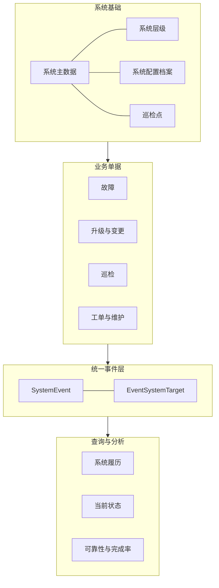

# 系统运行维护管理总体方案

> 版本：V2.3（灵活配置稿）
> 编制日期：2026-09-17
> 适用范围：系统主数据、系统配置档案、故障、升级、巡检、工单及系统履历
> 修订说明：本版不再以单台设备和可追踪部件为管理核心，改为以实际运行的系统为基本管理单元。

## 1. 方案摘要

本方案以“系统”为唯一核心管理对象，统一管理系统主数据、系统配置档案、故障、升级、巡检、工单和运行履历。

本版不建立逐台设备资产管理体系。服务器、交换机、板卡、模块等具体设备，默认只作为系统配置组成项或业务事件发生时的现场描述，不建立独立状态、系统—设备关系和设备履历。已有设备台账继续保留，作为历史资料或外部资产信息来源，不再作为新方案流程运行的前提。

核心结论如下：

1. 系统是故障、升级、巡检、工单和履历的统一业务对象。
2. 一个系统对象代表某地点实际运行的一套系统实例，不代表抽象产品类型。
3. 系统的固定属性和个性化属性通过可配置的系统配置档案管理，不要求每台设备逐一建档。
4. 具体设备信息仅在确有需要时记录为配置组成项、资产引用或事件快照。
5. 业务单据是事实来源，系统履历由业务动作自动生成，不重复录入。
6. 系统运行状态由故障、工单和恢复确认共同决定。
7. 巡检以“系统—巡检点—检查项”为结构，不以逐台设备建档为前提。
8. 机房无网络时，采用任务预下载、现场离线执行、返回内网后幂等同步的方式。

## 2. 方案目标和范围

### 2.1 方案目标

- 建立统一、稳定的系统主数据，消除故障和升级记录中的自由系统名称。
- 形成覆盖日常运行、故障处置、升级变更、巡检和维护的业务闭环。
- 通过系统配置档案了解系统当前及历史的组成、版本和关键配置。
- 将故障、升级、巡检和工单统一关联到系统。
- 建立可追溯、不可静默覆盖的系统履历。
- 支持内网无 WiFi 场景下的离线巡检。
- 在满足运维管理的前提下降低建档、维护和迁移成本。

### 2.2 本方案范围

- 系统主数据和系统层级。
- 系统运行状态。
- 系统配置档案、类型模板及历史变更。
- 故障、系统升级、巡检、工单和预防性维护。
- 统一系统履历、提醒、统计和审计。
- 离线巡检任务包、现场执行和同步。
- 现有故障、升级和设备历史数据的渐进迁移。

### 2.3 明确不纳入的范围

- 单台设备的采购、到货、入库、领用、调拨、借用、折旧、报废和处置。
- 系统—设备多对多关系及其历史有效期管理。
- 可追踪部件的建档、安装、拆卸、移动和独立履历。
- 完整仓储、备件库存、财务资产和采购审批。
- 强制将所有存量设备逐台映射到系统。
- 所有低价值设备和耗材的逐件编码。

上述能力应优先由现有固定资产、采购、库存等系统承担。本系统只保存必要的外部编号、引用或业务快照。

## 3. 核心概念和管理粒度

### 3.1 系统

系统是能够独立明确责任主体、运行状态、配置档案和故障影响范围的实际运行单元。

系统建档遵循以下粒度规则：

- 同一名称但部署地点、责任主体或运维边界不同的，应建立不同系统对象。
- 同一地点内不能独立运行、不能独立定责的组成部分，不单独建立系统对象。
- 大型系统可拆分为子系统，但服务器、交换机、板卡等物理设备默认不作为子系统。
- 系统类型用于分类，不能代替具体系统实例。

例如，“某型号通信系统”是系统类型，“烟台中心站通信系统”才是具体系统对象。

### 3.2 子系统

子系统是具有相对独立功能、责任或运维边界的系统组成单元。系统与子系统采用树形层级，首期每个子系统只允许一个直接上级，避免形成难以维护的复杂关系网。

故障、升级、巡检和工单应尽量关联最准确的系统层级。上级系统可汇总查看下级系统事件，但不能把同一事件重复生成多份履历。

### 3.3 系统配置档案

系统配置档案采用“固定核心字段 + 系统类型模板 + 用户自定义字段 + 可选组成项”的混合结构。它用于说明系统的实际属性、组成和关键配置，不把每台设备变成独立管理对象。

固定核心字段包括系统编号、名称、类型、部署位置、责任部门、负责人、重要等级和运行状态。系统管理员可以为系统类型定义扩展字段，用户再为具体系统填写实际值。

支持的自定义字段类型包括：文本、长文本、数字、日期、单选、多选、布尔值、附件和明细表。字段可以配置是否必填、默认值、选项、格式校验、可见范围和可编辑角色。

系统配置档案可按需要记录：

- 软件、应用和固件版本。
- 网络、接口、频率等必要配置摘要。
- 设备、软件、模块、链路等组成项的名称、类别、型号、数量和用途。
- 可选的资产编号、序列号或外部系统引用。
- 拓扑、配置文件和其他附件。

自定义字段用于适应不同系统类型的差异。例如通信系统可配置频率和接口字段，软件系统可配置数据库和版本字段。字段定义不能包含密码、令牌和私钥。

### 3.4 巡检点

巡检点是系统内需要现场检查的稳定位置或功能点，例如机柜、电源区域、主用服务器区、操作席或链路状态。巡检点用于组织路线、二维码和检查项，但不是设备资产，也不形成独立履历。

### 3.5 业务单据和履历事件

故障单、升级单、巡检任务和工单是业务事实来源。

系统履历事件由业务动作生成，保存来源、动作、发生时间、操作人、关联系统及事件发生时快照。履历不是第二套业务表，不允许脱离业务单据重复维护。

## 4. 总体业务架构



总体原则：

- 系统主数据提供稳定 ID，业务模块不得继续只保存自由填写的系统名称。
- 系统配置档案描述系统属性和组成，业务事件描述系统发生了什么。
- 业务单据完成自身事务后，通过统一履历服务生成事件。
- 一条事件可以关联一个主体系统和多个受影响系统。
- 上级系统的汇总视图读取下级事件，不复制事件数据。

## 5. 系统主数据和层级

### 5.1 系统主数据

| 字段 | 含义 | 规则 |
| --- | --- | --- |
| `system_code` | 系统编号 | 租户内唯一，启用后原则上不可修改 |
| `name` | 系统正式名称 | 必填，可变更但保留历史快照 |
| `short_name` | 系统简称 | 可选 |
| `system_type` | 系统类型 | 用于分类和字段模板 |
| `parent_id` | 上级系统 | 可选，禁止循环引用 |
| `location` | 部署地点 | 建议必填 |
| `owner_department` | 责任部门 | 必填 |
| `owner` | 系统负责人 | 必填 |
| `technical_owner` | 技术负责人 | 可选 |
| `criticality` | 重要等级 | 一般、重要、关键 |
| `health_status` | 运行健康状态 | 由业务事实计算或受控确认 |
| `is_active` | 是否可用 | 仅控制业务候选项，不表达运行状态 |
| `purpose` | 系统用途 | 建议填写 |
| `description` | 系统说明 | 可选 |
| 审计字段 | 创建、更新、停用等信息 | 必须 |

系统改名、调整负责人或部署地点时，不覆盖历史事件中的快照。

### 5.2 系统层级规则

- 一个系统最多有一个直接上级。
- 禁止将系统设置为自身或其下级的子系统。
- 子系统状态不自动等同于上级系统状态。
- 上级系统健康状态可以汇总展示，但故障事实和人工确认必须可追溯。
- 跨系统依赖首期只在说明或系统配置档案中记录，不建立复杂依赖关系网。

### 5.3 删除保护

已被故障、升级、巡检、工单或履历引用的系统不得物理删除。系统不再使用时，只关闭其业务候选资格或软删除，历史记录必须继续可查。

## 6. 系统配置档案

### 6.1 配置结构

系统配置采用分层结构：

```text
固定核心字段
└─ 所有系统共同具备，由平台定义

系统类型模板
└─ 管理员为某类系统配置通用扩展字段

系统自定义字段
└─ 经授权后为某个具体系统补充个性字段

可选组成项
└─ 按需要记录设备、软件、模块或链路，不要求逐台建档
```

固定核心字段使用正式数据库字段，保证权限、查询和业务关联稳定。动态字段和值使用独立的字段定义和配置值模型，不把全部配置塞进一个无约束、不可查询的 JSON 字段。

### 6.2 系统类型模板

系统管理员可以为每种系统类型配置字段模板。字段定义至少包括：

- 稳定字段编码和显示名称。
- 字段类型、帮助文字和显示顺序。
- 是否必填、默认值和格式校验规则。
- 单选或多选的候选项。
- 是否允许搜索、筛选和导出。
- 可见角色和可编辑角色。
- 是否属于敏感配置。

同类系统默认继承模板。管理员新增模板字段后，可以选择只应用于新系统，或让现有系统显示为空并逐步补录，不能自动伪造默认历史值。

例如，通信系统模板可以包含频率、接口和呼号；软件系统模板可以包含应用版本、数据库类型和部署方式。两类系统共用核心字段，但不显示彼此无关的扩展字段。

### 6.3 具体系统自定义

在类型模板不能满足需要时，经授权的管理员可以为某个具体系统增加自定义字段。为避免表单失控，应满足：

- 自定义字段仍使用稳定字段编码和受支持的字段类型。
- 字段名称不得与固定字段或模板字段重复。
- 可以限制只有系统管理员能够新增字段，普通用户只填写值。
- 同一含义在三个以上系统重复出现时，应提升为系统类型模板字段。
- 字段停用后不再出现在新编辑表单中，但历史值继续保留和显示。
- 修改字段类型前必须检查已有数据并提供转换或回退方案。

### 6.4 配置组成项

- 组成项可以按类型汇总，例如“接入交换机，某型号，4 台”。
- 只有对定位、保修或审计确有价值时，才填写单台资产编号或序列号。
- 组成项调整只更新系统配置档案，不需要设备调拨流程。
- 故障和工单可以引用组成项，也允许直接填写现场对象描述。
- 组成项被修改或删除后，历史业务事件快照保持不变。

### 6.5 配置历史

系统配置档案不强制执行复杂的版本发布流程。每次保存时记录变更人、变更时间、变更来源和字段前后值，形成可查看的配置历史。

重要升级或技术改造完成后，可以生成一次配置快照，用于比较变更前后的差异。普通字段调整只记录变更历史，不要求用户手工创建版本。

系统类型模板发生变化时，同样记录字段新增、修改、停用及操作人。删除字段定义不得级联删除已保存值。

密码、令牌和私钥不得保存为普通字段或附件。确需引用秘密配置时，只保存密钥管理系统中的引用标识。

### 6.6 建议数据模型

| 实体 | 作用 |
| --- | --- |
| `SystemType` | 系统类型和模板归属 |
| `ConfigFieldDefinition` | 字段编码、类型、作用范围、校验、顺序和权限 |
| `SystemConfigValue` | 具体系统在某个字段下的当前值 |
| `SystemConfigComponent` | 可选的设备、软件、模块或链路组成项 |
| `SystemConfigChange` | 字段或组成项变更前后值、来源、人员和时间 |
| `SystemConfigSnapshot` | 重要升级或改造时生成的可选配置快照 |

字段定义的作用范围区分系统类型和具体系统。配置值必须按字段类型校验；需要搜索和统计的字段应使用可查询的类型化值，不依赖源码约定或无约束 JSON。

## 7. 系统运行状态

系统运行状态包括正常、降级、故障、中断和未知，由故障、工单及恢复确认共同计算：

- 存在未恢复的中断故障时，显示“中断”。
- 不存在中断但存在未关闭故障时，显示“故障”或“降级”。
- 无未关闭故障且完成恢复确认后，才恢复为“正常”。
- 多张故障同时存在时，关闭其中一张不能覆盖其他故障造成的状态。
- 自动计算结果和高权限人工修正均必须形成审计和履历。

“正在维护”由未完成工单表达，不与运行状态混为一个字段。

系统名称、部署地点、责任主体、系统层级、重要等级、版本、关键组成、接口和业务参数发生变化时必须保留审计。影响系统配置档案的重要变化应通过升级单、变更单或工单完成。

## 8. 故障和系统升级

### 8.1 故障管理

故障单是故障事实的唯一来源，包含：

- 主故障系统，必须且只能有一个。
- 实际受影响系统，可多选。
- 故障时间、现象、级别和影响范围。
- 故障位置或巡检点。
- 具体对象描述，可引用配置组成项，也可填写设备型号、编号或序列号快照。
- 原因、处置过程、恢复时间和最终结果。
- 是否生成维修工单。

故障必须关联最准确的系统层级。上级系统通过汇总视图查看下级故障；只有实际受到影响时，才作为受影响系统关联事件。

关闭故障后，系统根据其他未关闭故障和工单重新计算健康状态，不能无条件恢复正常。

### 8.2 系统升级

升级单包含主升级系统、同批受影响系统、升级类型、升级前后版本、计划和实际时间、内容、风险、回退方案、执行步骤、状态日志及结果。

升级单不要求逐台选择受影响设备。确需说明设备级变更时，可引用配置组成项或填写对象快照。

升级完成、失败和回退分别生成来源明确的系统履历。升级产生配置变化时，应更新配置档案、记录字段差异，并可生成配置快照。

## 9. 巡检和预防性维护

### 9.1 巡检业务模型

```text
巡检策略
→ 巡检计划
→ 巡检任务
→ 系统巡检执行
→ 巡检点结果
→ 检查项结果
→ 异常
→ 故障单或工单
```

### 9.2 巡检策略

巡检策略配置在系统类型或具体系统上，包括巡检周期、适用范围、路线、巡检点、检查项、实测值范围、附件要求、异常等级、转单规则和超期规则。

系统类型提供默认模板，具体系统可以在受控范围内覆盖检查项和周期。

### 9.3 巡检点和二维码

二维码按两级使用：

- 机房或区域二维码用于确认到达现场并打开路线。
- 系统或关键巡检点二维码用于确认具体检查位置。

```text
TDYW|V1|ROOM|YANTAI-JF-01
TDYW|V1|SYSTEM|SYS-YT-001
TDYW|V1|POINT|SYS-YT-001-POWER
```

二维码不保存平台 URL、IP、频率、密码或其他敏感参数。标签只用于识别，不能单独证明巡检完成。

### 9.4 异常驱动的巡检表

- 正常项允许快速确认，关键项目必须填写实测值。
- 异常时展开原因、说明和附件。
- 暂时无法判断时允许标记“待复核”，不得强制填正常。
- 异常可以生成故障单、工单或待办。
- 不要求所有检查项每次拍照。

所有明细保存在巡检模块。正常巡检可按周期汇总进入系统履历；异常、参数调整和状态变化形成显著事件。异常转为故障后，后续处置由故障单和工单负责，避免重复履历。

### 9.5 离线巡检

机房无 WiFi 时，采用单位管理的安卓平板或手持终端：

```text
办公室登录并下载任务包
→ 现场离线扫描机房、系统或巡检点二维码
→ 填写结果、读数、异常和附件
→ 返回办公室连接受控内网
→ 批量上传并由服务端逐条校验
→ 终端仅清理确认同步成功的数据
```

离线任务包只包含本次任务的执行人、终端、有效期、路线、系统、巡检点、检查项、二维码映射、表单版本和完整性校验值。

同步必须满足：

- 使用终端生成的批次 ID 和记录 UUID 保证幂等。
- 服务端重新校验租户、用户、终端、权限和系统范围。
- 保存任务下载版本，不用最新表单覆盖已执行结果。
- 两人执行同一任务时保留双方数据并进入冲突处理。
- 附件支持分阶段上传、哈希校验、失败重试和断点续传。
- 上传成功前不得删除本地记录。

离线记录同时保存计划时间、任务包下载时间、终端采集时间、服务端接收时间和同步完成时间。终端时间不能被包装成绝对可信时间；超期、时间偏差和人工补录必须明确标记。

先在真实目标终端验证离线 PWA。若需要专用扫码头、设备证书、更强本地加密、后台上传或大批量附件，再选择原生安卓应用。

## 10. 工单和预防性维护

### 10.1 工单边界

故障单回答“发生了什么”，工单回答“由谁、何时、怎样处理”。一个故障可以产生一张或多张工单。

工单类型包括故障维修、定期巡检、预防性维护、安装调试、技术改造、配置变更、现场测试和校准。

### 10.2 工单内容

工单包含编号、类型、来源、目标系统、受影响系统、作业位置、具体对象描述、优先级、人员、计划和实际时间、步骤、工时、中断时间、材料明细、结果、复核和附件。

工单不承担备件库存和设备调拨。需要逐件追踪的材料应引用外部库存或资产系统编号。

### 10.3 事件所有权

| 事件 | 主要来源 |
| --- | --- |
| 故障发生和影响范围 | 故障单 |
| 维修开始、暂停和完成 | 维修工单 |
| 系统恢复运行 | 故障关闭或恢复确认 |
| 升级完成、失败和回退 | 系统升级单 |
| 正常巡检完成 | 巡检任务 |
| 巡检发现异常 | 巡检任务，后续事实转入故障单 |
| 配置档案重要变更 | 配置档案或来源业务单据 |

一条事件只能有一个主要来源，可以关联故障、工单或巡检记录作为上下文。

## 11. 统一系统履历

### 11.1 数据模型

| 实体 | 作用 |
| --- | --- |
| `SystemEvent` | 事件类型、标题、摘要、时间、来源、动作、操作人和状态 |
| `EventSystemTarget` | 关联系统、目标角色及事件发生时快照 |
| `EventCorrection` | 关联原事件并保存更正原因、人员和时间 |

`EventSystemTarget.target_role` 支持：

- `PRIMARY`：事件主体系统。
- `AFFECTED`：实际受影响系统。
- `RELATED`：关联但未直接受影响的系统。

使用 `tenant_id + source_type + source_id + action` 建立来源唯一约束，防止接口重试产生重复事件。

### 11.2 关联规则

| 业务事件 | 主体系统 | 受影响系统 | 来源 |
| --- | --- | --- | --- |
| 系统升级完成或回退 | 必须 | 可多个 | 升级单 |
| 故障发生和恢复 | 必须 | 可多个 | 故障单 |
| 工单执行和完成 | 必须 | 可多个 | 工单 |
| 巡检完成 | 必须 | 无 | 巡检任务 |
| 巡检异常 | 必须 | 可选 | 巡检任务或故障单 |
| 配置档案重要变更 | 必须 | 无 | 配置档案或来源业务单据 |

### 11.3 生成规则

1. 业务模块在数据库事务中完成自身状态变化。
2. 调用统一履历服务，传入来源、动作、发生时间和系统目标。
3. 服务端重新查询系统及权限，不信任前端传来的名称和状态。
4. 保存事件时的系统编号、名称和状态快照。
5. 通过来源唯一键保证幂等。
6. 业务保存或履历生成失败时整体回滚。
7. 已发布事件不得静默修改；更正时新增记录并关联原事件。

## 12. 页面和菜单

```text
系统运行维护
├─ 系统管理
│  ├─ 系统列表
│  ├─ 系统层级
│  ├─ 系统类型模板
│  └─ 系统配置档案
├─ 运行维护
│  ├─ 故障管理
│  ├─ 系统升级
│  ├─ 巡检管理
│  └─ 工单管理
└─ 履历与分析
   ├─ 系统履历
   ├─ 运行状态
   └─ 统计分析
```

系统详情包含基本信息、责任主体、上下级系统、当前状态、配置档案及历史、巡检、故障、升级、工单和系统履历。

现有设备列表和设备履历在过渡期可保留为独立的“历史设备台账”，但不放入新方案核心流程。

## 13. 权限、审计和安全

### 13.1 权限域

- 系统主数据：查看、创建、编辑、停用、层级维护、导出。
- 系统类型模板：查看、创建、编辑、停用字段、调整校验和权限。
- 系统配置档案：查看、编辑、自定义字段管理、历史查看、快照和导出。
- 巡检：策略、计划、任务、执行、补录、复核、导出。
- 工单：创建、派发、接单、执行、复核、关闭、更正。
- 故障：报障、定位、处置、关闭、更正。
- 升级：申请、执行、完成、回退、更正。
- 履历：查看、导出、更正申请和高权限撤销。

前端按钮和路由权限必须与后端权限一致，后端必须独立校验。

### 13.2 审计和安全

- 系统、字段模板、配置档案和业务单据的重要创建、修改、状态变化、删除和导出必须记录审计日志。
- 关键业务事件不允许普通用户硬删除，更正必须说明原因。
- 离线巡检保存终端、任务包、时间、同步批次和补录标记。
- 所有查询和写入必须重新执行租户和对象范围校验。
- 密码、令牌、私钥不得写入普通字段、附件或二维码。
- IP、频率和拓扑等敏感配置按权限控制查看和导出。

## 14. 提醒和分析

逐步建立巡检维护、故障工单、配置档案复核、合同维保和证书支持等到期提醒。

数据可靠后计算：

- 系统故障次数、MTTR、可用率和累计中断时间。
- 降级运行时间。
- 巡检完成率、逾期率和异常率。
- 工单完成率和平均处理时长。
- 升级成功率和回退次数。

不再以单台设备为基础计算设备年龄、设备 MTBF 或部件更换次数。

## 15. 现有数据迁移

### 15.1 迁移原则

- 先建立系统主数据，再让业务记录引用稳定系统 ID。
- 历史文本保留为快照，不覆盖原始内容。
- 不按相似名称自动强制合并系统。
- 无法确认的历史记录保留原文本并标记“未映射”。
- 迁移脚本可重复执行，并输出数量、冲突和未映射报告。
- 不要求把全部存量设备逐台归属到系统。
- 不删除已有设备、故障、升级和履历数据。

### 15.2 迁移阶段

| 阶段 | 主题 | 主要工作 |
| --- | --- | --- |
| 0 | 数据盘点 | 盘点系统名称、升级、故障、设备和现有履历 |
| 1 | 系统主数据 | 将 `UpgradeSystem` 和确认后的名称提升为正式系统 |
| 2 | 配置模板 | 定义首批系统类型、扩展字段和校验规则 |
| 3 | 历史映射 | 建立名称到系统 ID 的人工确认映射 |
| 4 | 故障改造 | 增加主故障系统和受影响系统关联 |
| 5 | 升级改造 | 增加正式系统关联和配置变更记录 |
| 6 | 系统履历 | 建立统一事件和系统目标关联 |
| 7 | 巡检工单 | 建立系统级巡检、巡检点和工单闭环 |
| 8 | 离线巡检 | 建立任务包、终端授权和同步服务 |
| 9 | 收紧约束 | 停止新增自由系统名称并完善约束 |

### 15.3 现有设备台账处理

- `DeviceResume` 和现有设备履历继续保留，首期不删除、不强制改造。
- 新业务不要求先选择设备才能报故障、建工单或执行巡检。
- 有价值的历史设备信息可以人工选择性引用或导入为组成项。
- 未确认的设备归属不自动猜测，不阻塞系统主数据上线。
- 是否由外部资产系统接管设备台账，另行评估。

## 16. 分阶段实施建议

### 第一阶段：系统主数据和统一关联

- 系统列表、系统层级和管理粒度规则。
- 故障、升级关联正式系统。
- 统一系统履历和目标关联。
- 基础权限、审计和历史数据映射。

### 第二阶段：系统配置档案

- 系统类型模板、动态字段和校验规则。
- 具体系统自定义字段及权限控制。
- 配置组成项、变更历史和可选快照。
- 系统主数据重要变更审计。

### 第三阶段：系统级巡检和工单

- 巡检策略、计划、任务、巡检点和检查项。
- 异常转故障或工单。
- 维修、维护和技术改造工单。

### 第四阶段：离线巡检

- PWA 或原生安卓应用技术验证。
- 任务包、离线授权、批量同步和附件续传。
- 二维码标签和终端管理。

### 第五阶段：提醒和分析

- 维保、证书、配置档案复核和任务到期提醒。
- MTTR、可用率、中断时间、巡检和工单分析。
- 与固定资产、采购、库存等外部系统按需集成。

## 17. 核心验证场景

| 场景 | 预期结果 |
| --- | --- |
| 系统粒度 | 同名但不同地点或责任主体的系统可以独立建档和定责 |
| 系统层级 | 上级可汇总查看下级事件，事件不被重复生成 |
| 类型模板 | 不同系统类型展示不同字段和校验规则 |
| 个性配置 | 授权用户可为具体系统增加字段，不影响其他系统 |
| 字段演进 | 字段停用或调整后历史值和变更记录仍可查询 |
| 设备降级 | 未建立设备档案仍可完成故障、升级、巡检和工单闭环 |
| 故障影响 | 一条故障可关联一个主体系统和多个实际受影响系统 |
| 状态联动 | 关闭一张故障不会覆盖其他未关闭故障造成的健康状态 |
| 系统升级 | 升级结果进入系统履历并记录配置差异或快照 |
| 系统巡检 | 按系统和巡检点执行，不要求逐台设备建档 |
| 离线巡检 | 无网络完成巡检，回网同步后不重复、不丢数据 |
| 异常闭环 | 巡检异常可生成故障或工单并保留来源追溯 |
| 历史迁移 | 无法映射的旧记录保留原文本并明确标记 |
| 租户隔离 | 相同系统编号可存在于不同租户，数据互不可见 |
| 删除保护 | 被引用系统不能物理删除，历史仍可查询 |

## 18. 待确认事项

1. 系统和子系统的首批建档清单及边界由哪些部门共同确认。
2. 是否允许故障先按上级系统报障，定位后更正为具体子系统。
3. 系统配置档案需要记录到何种详细程度，哪些敏感参数只保存引用。
4. 哪些角色可以维护系统类型模板和具体系统自定义字段。
5. 现有设备台账长期只读保留，还是未来对接固定资产系统。
6. 巡检使用机房二维码、系统二维码还是关键巡检点二维码。
7. 现场是否允许携带单位专用终端，以及办公室可用的同步网络方式。
8. 正常巡检进入系统履历时采用月度汇总还是按巡检周期汇总。
9. 系统健康状态是否允许高权限人工修正，以及修正的有效期和复核方式。

## 19. 结论

本方案形成以下系统中心结构：

```text
系统主数据和系统层级定义管理对象
系统类型模板和自定义字段提供灵活的配置档案
故障、升级、巡检和工单记录业务事实
统一事件形成可追溯的系统履历
状态、提醒和统计反映系统运行与维护情况
```

具体设备不再是新方案的必建对象。需要了解系统属性和组成时，通过类型模板、自定义字段及可选组成项记录；需要定位故障或作业对象时，通过组成项引用或事件快照记录；需要管理设备资产和库存时，通过外部系统承担。这样既给用户足够的配置灵活性，又避免逐台设备建档、关系维护、状态联动和部件流转带来的过高实施成本。
